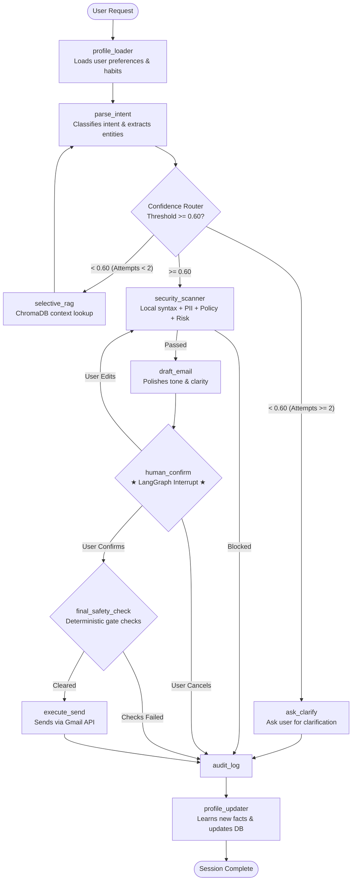

# 🔐 ARIA: Autonomous Response & Inbox Assistant

> **Enterprise-grade, verification-gated AI executive assistant for Google Workspace (Gmail & Calendar) built with LangGraph, FastAPI, and Streamlit.**

[](https://fastapi.tiangolo.com)
[](https://github.com/langchain-ai/langgraph)
[](https://streamlit.io)
[](https://www.python.org)

ARIA is not a simple auto-sending email bot. It is an **agentic workflow assistant** engineered around **safety gates, human-in-the-loop verification, and adaptive profile memory**. Every outbound action passes through an orchestrated verification pipeline before anything reaches the Google Workspace APIs.

---

## 📖 Table of Contents
1. [ARIA Explained in Plain English](#-aria-explained-in-plain-english)
2. [Key Features](#-key-features)
3. [Architecture & LangGraph Flow](#-architecture--langgraph-flow)
4. [Deep Dive: Code Explanations by Module](#-deep-dive-code-explanations-by-module)
   - [State Management (`state.py`)](#1-state-management-backendstatepy)
   - [LangGraph Orchestration (`graph.py`)](#2-langgraph-orchestration-backendgraphpy)
   - [Intent & Entity Extraction (`nodes/intent.py`)](#3-intent--entity-extraction-backendnodesintentpy)
   - [The 6-Gate Verification Chain (`nodes/verification/`)](#4-the-6-gate-verification-chain-backendnodesverification)
   - [Adaptive Profile Memory (`backend/profile/`)](#5-adaptive-profile-memory-backendprofile)
   - [Multi-LLM Engine (`backend/utils/llm.py`)](#6-multi-llm-engine-backendutilsllmpy)
   - [Audit Logging (`backend/nodes/audit.py`)](#7-immutable-audit-logging-backendnodesauditpy)
5. [Step-by-Step Request Lifecycle](#-step-by-step-request-lifecycle)
6. [Repository Structure](#-repository-structure)
7. [Quickstart & Setup](#-quickstart--setup)
8. [Frequently Asked Questions (FAQ)](#-frequently-asked-questions-faq)

---

## 💡 ARIA Explained in Plain English

Imagine you hire a high-level executive assistant named **ARIA** to manage your correspondence.

If you say: *"Tell Priya the meeting is delayed to 4 PM"*, an ordinary AI bot might immediately send an uncontrolled email that could be rude, contain typos, or leak private information.

**ARIA never does that.** Instead, ARIA behaves like a diligent human professional:
1. **Checks Memory**: ARIA checks their notepad for who "Priya" is, what email address she uses, and how you normally talk to her.
2. **Drafts Carefully**: ARIA writes a polished, professional message draft.
3. **Runs Security Check**: ARIA inspects the letter for accidental secrets (passwords, bank numbers, API keys), spam phrasing, or bad recipient domains.
4. **Brings it to Your Desk (Human-in-the-Loop)**: ARIA pauses and hands you the clipboard: *"Here is the email to priya@corp.com with subject and body. Do you approve, want changes, or want to cancel?"*
5. **Sends Only Upon Approval**: Only after you sign off does ARIA hand it to the post office (Gmail API).
6. **Logs & Learns**: ARIA logs the event into an immutable ledger and updates their memory about Priya so future interactions are even smoother.

---

## 🚀 Key Features

- **🛡️ 6-Gate Verification Chain**:
  - **Gate 1 (Confidence)**: Ambiguity detection (threshold ≥ 0.60). Automatically triggers selective RAG to disambiguate or requests clarification.
  - **Gate 2 (Recipient Validation)**: Email syntax regex, disposable domain blocklist (`tempmail`, `mailinator`), and context match.
  - **Gate 3 (PII Scanner)**: Detects passwords, API tokens, financial cards, SSN/Aadhaar/PAN, and server credentials.
  - **Gate 4 (Content Policy)**: Blocks harassment, abusive language, spam patterns, and tone mismatches.
  - **Gate 5 (Risk Scorer)**: Evaluates action reversibility, content sensitivity, and recipient risk (LOW / MEDIUM / HIGH).
  - **Gate 6 (Human Confirmation)**: Pauses execution using LangGraph state interrupts (`interrupt_before=["human_confirm"]`), providing a live draft preview with full options to **Confirm & Send**, **Edit & Re-verify**, or **Cancel**.
- **🧠 Continuous Memory & Profile Adaptation**:
  - Dynamically learns user habits, top contacts, calendar constraints, and preferences across 6 distinct life categories.
  - Rewrites affected profile sections in under 3 present-tense sentences to prevent token bloat and memory drift.
  - Primary storage in MongoDB Atlas with seamless zero-config fallback to local JSON files.
- **⚡ Optimized Inference**:
  - Consolidated architecture requiring only **4 LLM calls per email action** (down from 7).
  - Flexible multi-provider support: GitHub Models (`openai/gpt-4.1`), Google Gemini (`gemini-1.5-flash`), or OpenAI (`gpt-4o-mini`).
- **📋 Immutable Audit Logging**:
  - Unconditionally records all actions (`SENT`, `BLOCKED`, `CANCELLED_BY_USER`, `CLARIFICATION_REQUESTED`) to an append-only audit trail (`aria_audit.jsonl`).

---

## 🏗️ Architecture & LangGraph Flow



---

## 🔬 Deep Dive: Code Explanations by Module

### 1. State Management (`backend/state.py`)
In LangGraph, all information flows through a shared dictionary called `AgentState`. Every node receives this state, performs work, and returns a dictionary with updated fields.

```python
class AgentState(TypedDict, total=False):
    # Core conversation
    original_input:     str         # Raw text entered by the user
    thread_id:          str         # Unique UUID for the session
    user_id:            str         # Identifier for user profile
    
    # Intent & Confidence
    intent:             str         # "send_email", "schedule_event", etc.
    confidence:         float       # 0.0 to 1.0 confidence score
    
    # Extracted Entities
    recipient_name:     str         # e.g., "Priya"
    recipient_email:    str         # e.g., "priya@corp.com"
    subject:            str         # Subject line
    body_draft:         str         # Full email body text
    tone:               str         # "formal", "casual", or "urgent"
    
    # Security & Verification
    pii_clean:          bool        # True if no secrets/passwords found
    recipient_validated:bool        # True if valid email format & domain
    overall_risk:       str         # "LOW", "MEDIUM", or "HIGH"
    blocked:            bool        # True if any safety gate blocks the action
    
    # Human Gate & Execution
    confirmed:          bool        # True when user clicks "Confirm & Send"
    cleared_to_send:    bool        # Final green light from safety node
    send_success:       bool        # True after Gmail API executes
```
*Why this matters*: Every node is pure and predictable. No global variables are used, and state can be serialized, saved, or restored at any point.

---

### 2. LangGraph Orchestration (`backend/graph.py`)
The graph builder wires all nodes together into a stateful workflow with conditional routing and checkpointing.

- **Checkpointer (`MemorySaver`)**: Remembers thread state between different HTTP requests.
- **Interrupts (`interrupt_before=["human_confirm"]`)**: Tells LangGraph to pause execution right before sending. The backend returns control to the frontend, displays the review screen, and waits for user confirmation before resuming.

```python
def build_graph(checkpointer=None):
    g = StateGraph(AgentState)
    
    # 1. Register nodes
    g.add_node("profile_loader",     profile_loader_node)
    g.add_node("parse_intent",       parse_intent_node)
    g.add_node("security_scanner",   security_scanner_node)
    g.add_node("draft_email",        draft_email_node)
    g.add_node("human_confirm",      human_confirm_node)
    g.add_node("final_safety_check", final_safety_check_node)
    g.add_node("execute_send",       execute_send_node)
    g.add_node("audit_log",          audit_log_node)
    g.add_node("profile_updater",    profile_updater_node)

    # 2. Add routing logic
    g.add_conditional_edges("entity_extractor", confidence_router, {
        "proceed": "security_scanner",
        "rag":     "selective_rag",
        "clarify": "ask_clarify",
    })
    
    # Compile with human confirmation pause
    return g.compile(
        checkpointer=checkpointer,
        interrupt_before=["human_confirm"]
    )
```

---

### 3. Intent & Entity Extraction (`backend/nodes/intent.py`)
Earlier versions of autonomous agents used one LLM call to classify the intent and a second LLM call to extract names, emails, and subjects. ARIA unifies these into **one single prompt**:

```python
INTENT_AND_ENTITY_PROMPT = """
User profile context:
{profile_context}

User message: "{user_input}"

Do TWO things in one response:
1. Classify the intent (send_email, draft_email, schedule_event, etc.)
2. Extract ALL email entities and write a complete ready-to-send email body.
Return JSON only: { "intent": "...", "confidence": 0.95, "recipient_email": "...", "subject": "...", "body_draft": "..." }
"""
```
*Optimization*: Cuts latency in half during the initial parsing stage.

---

### 4. The 6-Gate Verification Chain (`backend/nodes/verification/`)

#### 🛡️ Gate 1: Confidence Router (`nodes/confidence.py`)
Evaluates if the model understands the request with at least **60% confidence** (`confidence >= 0.60`).
- If confidence is high $\rightarrow$ proceed to security scanning.
- If confidence is low ($< 0.60$) $\rightarrow$ query ChromaDB (`selective_rag`) up to 2 times to find past context. If still ambiguous, ask the user directly for clarification.

#### 🛡️ Gate 2–5: Combined Security Scanner (`nodes/verification/security_scanner.py`)
Combines recipient validation, PII scanning, content policy, and risk assessment:
1. **Local Deterministic Checks** (Zero LLM cost):
   - Regex format check (`^[\w\.\+\-]+@[\w\.\-]+\.\w{2,}$`).
   - Disposable email blocklist (`tempmail.com`, `mailinator.com`, `throwaway.email`, etc.).
2. **Unified LLM Security Scan**:
   - **PII Scan**: Flags passwords, database connection strings, API tokens, Aadhaar/SSN/PAN numbers, and credit cards.
   - **Content Policy**: Flags hostile/threatening wording, spammy patterns (excessive exclamation marks, ALL CAPS), and tone mismatches.
   - **Risk Scorer**: Evaluates recipient (Internal = LOW, External = MEDIUM, Unknown = HIGH) and reversibility (sending is HIGH risk).

#### 🛡️ Gate 6: Human Confirmation & Final Safety (`final_safety.py`)
Before anything touches Google's APIs, a deterministic rule engine confirms:
```python
checks = {
    "recipient_validated": state.get("recipient_validated", False),
    "confirmed":           state.get("confirmed", False),
    "not_blocked":         not state.get("blocked", False),
    "risk_acceptable":     state.get("overall_risk") in ("LOW", "MEDIUM"),
    "pii_ok":              state.get("pii_clean", False),
}
```
If any flag is False, the action is blocked unconditionally.

---

### 5. Adaptive Profile Memory (`backend/profile/`)
ARIA avoids the fatal flaw of standard RAG systems (which continuously append chat history until token limits explode).

ARIA maintains **6 compact life sections**:
1. `gmail_section`: Email habits and frequent correspondents.
2. `calendar_section`: Working hours, daily standups, and busy slots.
3. `food_section`: Food preferences and dietary restrictions.
4. `travel_section`: Daily commute and travel preferences.
5. `user_info_section`: Core facts about the user (role, timezone, team).
6. `contacts_section`: Key contacts and relationships.

#### The "Rewrite, Never Append" Rule (`updater.py`)
After each session, `extract_session_observations(state)` determines if anything new was learned. If so, an LLM rewrites the affected section into **under 3 present-tense sentences**:
```text
Good: "Frequently mails Priya about weekly invoices. Avoids meetings after 5 PM."
Bad:  "On Monday the user mailed Priya. On Tuesday the user also mailed Priya..."
```
This guarantees bounded memory size and constant prompt latency over months of usage.

---

### 6. Multi-LLM Engine (`backend/utils/llm.py`)
ARIA features a provider-agnostic LLM loader that automatically detects whichever key you have configured in your `.env`:
- **GitHub Models** (`GITHUB_TOKEN`): Free access to `openai/gpt-4.1` with a GitHub Personal Access Token.
- **Google Gemini** (`GEMINI_API_KEY`): Fast, cost-efficient inference via `gemini-1.5-flash`.
- **OpenAI** (`OPENAI_API_KEY`): Standard `gpt-4o-mini` or `gpt-4o`.

---

### 7. Immutable Audit Logging (`backend/nodes/audit.py`)
Every single request—whether it succeeded, was blocked by a safety gate, or was canceled by the user—is logged to `aria_audit.jsonl` with:
- Timestamp (UTC ISO-8601)
- Thread ID and User ID
- Recipient and Subject
- Risk Level & PII Items detected
- Final Outcome (`SENT`, `BLOCKED`, `CANCELLED_BY_USER`, `CLARIFICATION_REQUESTED`)
- Google Message ID (if sent)

---

## 🔄 Step-by-Step Request Lifecycle

Here is what happens when you enter:
> *"Send a formal email to priya@company.com requesting the updated quarterly performance report."*

| Step | Node | What Happens |
| :---: | :--- | :--- |
| **1** | `profile_loader` | Pulls user profile (e.g. *"Full-stack developer, works with Priya on reporting"*). |
| **2** | `parse_intent` | LLM outputs intent=`send_email`, recipient=`priya@company.com`, tone=`formal`, confidence=`0.95`. |
| **3** | `confidence_router` | Since `0.95 >= 0.60`, skips RAG and routes directly to verification. |
| **4** | `security_scanner` | Validates email syntax, scans for credentials/PII (none found), rates risk as `LOW/MEDIUM`. |
| **5** | `draft_email` | Polishes the email body to ensure high professional standards. |
| **6** | `human_confirm` | **LangGraph Interrupt fires.** Streamlit displays email preview and security check badges. |
| **7** | *User Action* | User clicks **✅ Confirm & Send** in the web dashboard. |
| **8** | `final_safety_check`| Re-checks all safety variables (`recipient_validated`, `confirmed`, `pii_clean`). |
| **9** | `execute_send` | Sends email via Gmail API; returns Gmail Message ID. |
| **10**| `audit_log` | Writes structured audit record to `aria_audit.jsonl`. |
| **11**| `profile_updater` | Records interaction with Priya in `gmail_section` and `contacts_section`. |

---

## 📁 Repository Structure

```
ARIA/
├── backend/
│   ├── graph.py                    # LangGraph StateGraph builder, nodes, and conditional edges
│   ├── main.py                     # FastAPI REST API (endpoints: /api/chat, /api/confirm, /api/edit, etc.)
│   ├── state.py                    # AgentState TypedDict (single source of truth for graph data)
│   ├── nodes/
│   │   ├── audit.py                # Immutable JSONL audit logger (aria_audit.jsonl)
│   │   ├── confidence.py           # Threshold router (proceed / RAG / clarify)
│   │   ├── draft_email.py          # LLM email drafting and polishing
│   │   ├── executor.py             # Calls Gmail API send_email()
│   │   ├── intent.py               # Combined intent parser + entity extractor
│   │   ├── profile.py              # Profile loader and session updater nodes
│   │   ├── rag.py                  # ChromaDB lazy-loaded vector store lookup
│   │   └── verification/
│   │       ├── security_scanner.py # Combined PII + Policy + Risk scanner
│   │       ├── human_confirm.py    # Passthrough interrupt target for UI confirmation
│   │       ├── final_safety.py     # Deterministic sanity checks before send
│   │       ├── recipient_validator.py
│   │       ├── pii_scanner.py
│   │       ├── content_policy.py
│   │       └── risk_scorer.py
│   ├── profile/
│   │   ├── schema.py               # UserProfile dataclass & serialization
│   │   ├── summarizer.py           # Builds [PERSONAL CONTEXT] bundle for prompts
│   │   └── updater.py              # Session observation extractor & section rewriter
│   └── utils/
│       ├── calendar_client.py      # Google Calendar API (list events, create events)
│       ├── db.py                   # MongoDB Atlas client with local JSON fallback
│       ├── display.py              # Colorama terminal status visualizer for CLI
│       ├── gmail_client.py         # Gmail API (list inbox, send email)
│       ├── llm.py                  # Flexible LLM provider setup (GitHub Models / Gemini / OpenAI)
│       └── token_manager.py        # Google OAuth 2.0 credentials & token refresh
├── frontend/
│   └── app.py                      # Streamlit UI (dual-column chat + verification cards + audit)
├── requirements.txt                # Python dependencies
├── .env.example                    # Environment variable template
└── README.md                       # Project documentation
```

---

## 🛠️ Quickstart & Setup

### 1. Clone & Install Dependencies
```bash
git clone https://github.com/Mukunth2906/ARIA.git
cd ARIA
pip install -r requirements.txt
```

### 2. Configure Environment Variables
Copy `.env.example` to `.env`:
```bash
cp .env.example .env
```

Open `.env` and add at least one AI API key:
```dotenv
# Option A: GitHub Models (Free Personal Access Token from https://github.com/settings/tokens)
GITHUB_TOKEN=ghp_your_token_here

# Option B: Google Gemini (Free API Key from https://aistudio.google.com/app/apikey)
# GEMINI_API_KEY=your_gemini_key_here

# Option C: OpenAI API
# OPENAI_API_KEY=sk-your_openai_key_here
```

*(Note: `MONGO_URI` is optional. If left blank, ARIA stores profiles locally in the `profiles/` directory.)*

### 3. Run the Servers

#### Terminal 1 — Start the FastAPI Backend (Port 8001):
```bash
python -m uvicorn backend.main:app --reload --port 8001
```

#### Terminal 2 — Start the Streamlit Frontend:
```bash
streamlit run frontend/app.py
```

Visit **`http://localhost:8501`** in your browser to start using ARIA.

---

## ❓ Frequently Asked Questions (FAQ)

#### Q: Can I run ARIA without Google credentials?
**Yes!** You can test the intent parsing, entity extraction, 6-gate verification chain, email drafting, and profile adaptation completely without Google credentials. The only step that requires `credentials.json` is the final physical delivery of the email via Gmail API.

#### Q: How do I switch from GitHub Models to Gemini or OpenAI?
Simply open `.env` and comment out `GITHUB_TOKEN` while setting `GEMINI_API_KEY` or `OPENAI_API_KEY`. The loader in `backend/utils/llm.py` automatically detects and initializes the corresponding model.

#### Q: Where are user profiles stored if I don't have MongoDB?
ARIA has a built-in zero-config file fallback in `backend/utils/db.py`. If `MONGO_URI` is not provided or fails to connect, profiles are saved as clean JSON files inside the `profiles/` folder.

#### Q: Can an email ever be sent without my approval?
**Never.** The LangGraph compilation explicitly registers `interrupt_before=["human_confirm"]`. The workflow physically pauses, and the final send node can only be reached if `state["confirmed"]` is set to `True` through an authenticated user action in the UI.

---

## 📄 License
This project is open-source and available under the [MIT License](LICENSE).
